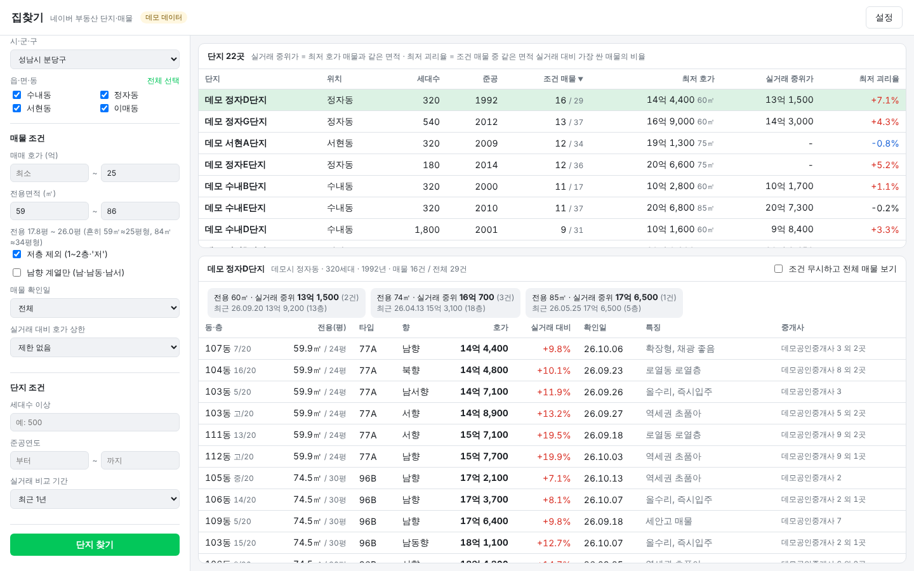

# 집찾기 (LandFinder)

네이버 부동산의 **매매 호가**와 **실거래가**를 조회해서 조건에 맞는 아파트 단지를 찾고, 단지를 고르면 조건에 맞는 매물을 보여주는 맥 앱입니다.



## 할 수 있는 것

1. **조건 입력** (왼쪽)
   - 지역: 시·도 → 시·군·구 → 읍·면·동(여러 개 선택 가능)
   - 매물 조건: 매매 호가 범위(억), 전용면적 범위(㎡), 저층 제외, 남향 계열만, 매물 확인일, 실거래 대비 호가 상한
   - 단지 조건: 세대수 하한, 준공연도 범위, 실거래 비교 기간(6개월·1년·2년)
2. **단지 목록** (오른쪽 위): 조건에 맞는 매물이 있는 단지만 보여줍니다. 열 제목을 누르면 정렬됩니다.
   - 조건 매물 수 / 전체 매매 매물 수
   - 최저 호가, 같은 면적의 실거래 중위가
   - 최저 괴리율: 조건에 맞는 매물 중 같은 면적 실거래 중위가 대비 가장 싼 매물의 비율
3. **매물 목록** (오른쪽 아래): 단지를 누르면 매물을 가격순으로 보여줍니다.
   - 동·층, 전용면적/공급평, 타입, 향, 호가, 실거래 대비 %, 확인일, 특징, 중개사
   - 면적별 실거래 요약(중위가, 거래 수, 최근 거래)
   - "네이버에서 보기"로 해당 매물 페이지를 엽니다.
   - "조건 무시하고 전체 매물 보기"로 그 단지의 매물을 모두 볼 수 있습니다.

같은 집을 여러 중개사가 올린 매물은 하나로 묶습니다(중개사 "외 N곳"으로 표시). 실거래는 계약 해제 건을 빼고, 같은 전용면적(㎡ 반올림)끼리만 비교합니다.

## 설치와 실행

필요한 것: macOS 11 이상, Python 3.9 이상(맥에 기본으로 있거나, 없으면 `xcode-select --install`로 설치됩니다).

```bash
git clone https://github.com/freshdev0719/AMD_SEV.git
cd AMD_SEV
git checkout claude/naver-land-finder
cd land-finder
./run.command            # 처음 한 번은 필요한 패키지 설치 (1~2분)
```

Finder에서 `run.command`를 더블클릭해도 됩니다. 처음 열 때 "확인되지 않은 개발자" 경고가 나오면 우클릭 → 열기를 선택하세요.

**Dock·Launchpad에서 여는 앱으로 만들기:**

```bash
./build_app.sh           # ~/Applications/집찾기.app 생성
```

앱은 이 폴더의 코드를 실행하므로 폴더를 옮겼다면 `build_app.sh`를 다시 실행하세요. 앱으로 열었을 때 생기는 로그는 `~/Library/Logs/LandFinder.log`에 남습니다.

**가짜 데이터로 화면만 보기:** `./run.command --demo` (단지명이 "데모 …단지"로 나옵니다)

**브라우저로 열기:** `./run.command --browser`

## 네이버 부동산 연결에 대해

- 네이버 부동산은 **공식 API가 없습니다.** 이 앱은 new.land.naver.com 웹사이트가 내부적으로 쓰는 API를 호출합니다. 네이버가 사이트를 바꾸면 동작하지 않을 수 있고, 그때는 `landfinder/naver.py`와 `landfinder/parse.py`만 고치면 됩니다.
- 이 코드는 네이버에 접속할 수 없는 환경에서 작성했습니다. API 응답 형식은 알려진 구조로 만든 샘플로만 테스트했으므로 **실제 네이버 데이터로는 아직 확인하지 못했습니다.**
- 네이버 이용약관은 자동화된 수집을 제한합니다. **개인적인 조회 용도로만** 쓰세요. 앱은 요청 사이에 기본 1초 간격을 두고, 결과를 캐시(지역 30일, 단지 목록 1일, 매물 30분, 실거래 12시간)해서 요청 수를 줄입니다.
- 한 번 검색할 때 매물까지 확인하는 단지는 최대 60곳입니다(세대수가 많은 순). 단지마다 매물 1~5번, 실거래 면적 타입당 1번씩 요청하므로 동을 너무 많이 고르면 오래 걸립니다.

### 조회가 안 될 때

설정(오른쪽 위)에서 토큰과 쿠키를 직접 넣을 수 있습니다.

1. 크롬이나 사파리에서 https://new.land.naver.com 을 열고 아무 단지나 누릅니다.
2. 개발자도구(⌥⌘I) → 네트워크 탭에서 `api/`로 시작하는 요청을 고릅니다.
3. 요청 헤더의 `authorization` 값에서 `Bearer ` 뒤 부분을 **토큰**에, `cookie` 값을 **쿠키**에 붙여 넣습니다.

"요청을 제한하고 있습니다"가 나오면 잠시 기다리거나 요청 간격을 늘리세요.

설정과 캐시는 `~/Library/Application Support/LandFinder/`에 저장됩니다.

## 구조

```
landfinder/
  naver.py     네이버 부동산 API 클라이언트 (토큰, 요청 간격, 재시도, 캐시)
  parse.py     응답 JSON → 모델 (가격 "15억 7,500" → 157500만원, 층 "저/25" 등)
  search.py    검색 조건, 매물 필터, 단지 검색, 실거래 비교
  web.py       화면이 부르는 로컬 API (FastAPI)
  demo.py      가짜 데이터
  static/      화면 (HTML/CSS/JS, 라이트·다크 모드)
  __main__.py  실행: 서버를 띄우고 pywebview 네이티브 창으로 연다
tests/         pytest (네이버 응답 샘플, 가짜 네이버 서버로 재시도·토큰 갱신 확인)
```

테스트: `pip install -r requirements-dev.txt && pytest`

> 매물·실거래 정보는 네이버 부동산과 국토교통부 공개 자료를 그대로 보여주는 참고 자료입니다. 거래 전에 반드시 직접 확인하세요.
